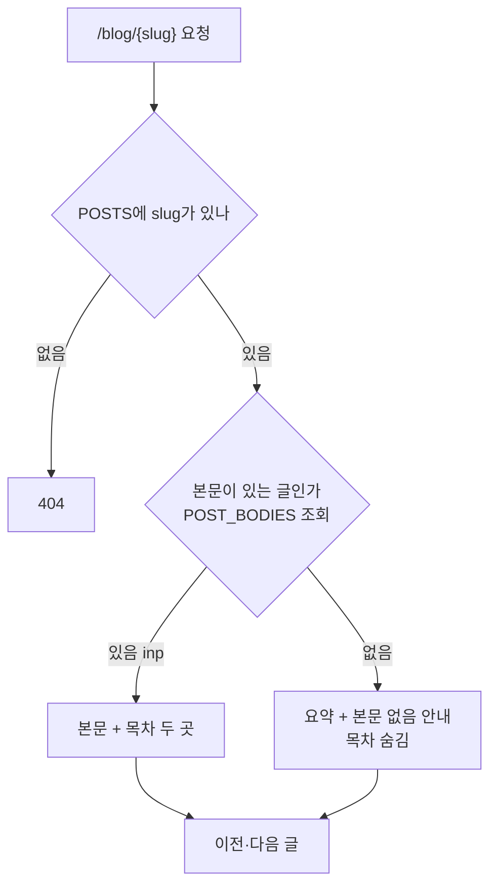

# 계획: 글 상세 페이지 마크업

`/blog/{slug}`에 시안 A의 글 상세 화면(`data-view="post"`)을 만듭니다. 왼쪽 본문 칸에는 글 목록으로 돌아가는 링크, 글 머리(태그·제목·날짜), 본문, 이전·다음 글이 들어가고, 오른쪽 좁은 칸에는 목차가 들어갑니다. 아직 콘텐츠 시스템이 없으므로 시안처럼 `inp` 글 하나만 본문을 JSX로 쓰고, 나머지 네 글은 요약과 "본문 없음" 안내를 보여 줍니다. 이번 작업은 마크업과 스타일에 더해, 코드 복사와 오른쪽 목차의 현재 위치 표시까지입니다. 나머지 동작(읽기 진행 막대, 이어 읽기, 맨 위로, 줄 강조)은 후속 작업으로 나눕니다.

**완료 조건**

- 홈의 글 카드·목록 다섯 개를 누르면 각 글 상세가 뜹니다. 없는 slug는 404입니다.
- 데스크톱(1280px)과 모바일(375px)에서 시안의 글 상세와 크기·간격·색이 같습니다. 872px 이상에서는 오른쪽 목차가, 그보다 좁으면 본문 위 목차 상자가 보입니다.
- 라이트·다크 테마 모두 시안의 색 토큰을 씁니다.
- 목차 항목을 누르면 해당 소제목으로 이동하고, 소제목이 헤더에 가리지 않습니다.
- 브라우저 탭 제목이 `{글 제목} — sungkyu.dev`입니다.
- `pnpm lint`와 타입 검사를 통과합니다.

## 입력 근거

- 디자인 시안: `design/blog-a.html`
  - 스타일: 80~81행(`.tag`, `.meta`), 115행(`.tags`), 128~170행(`/* post */`), 236~242행(코드 줄 번호, 줄 참조), 300행(화면 등장 모션), 308행(`.pager a:active`)
  - 마크업: 377~392행
  - 본문 예시와 렌더 방식: 629~646행(`FULL`), 648~675행(`renderPost`)
  - 탭 제목: 762행
- 사람 요청: "시안에서 글 상세 페이지를 구현하려고 해 참고 및 파악해서 마크업 진행해줘"
- 이전 작업: [home-content-columns.md](./home-content-columns.md)의 「후속 작업」에서 태그 칩 공용화를 "글 상세 머리를 만들 때"로 미뤘습니다.

## 현재 코드 상태

| 위치                                    | 상태                                                                                                                        |
| --------------------------------------- | --------------------------------------------------------------------------------------------------------------------------- |
| `app/page.tsx:7`                        | `<main>`이 본문 폭(1080px)·여백(위 72px, 아래 96px)과 등장 모션(`animate-rise-view`)을 갖습니다. 글 상세도 같은 값을 씁니다 |
| `components/Header.tsx:52`              | "글" 메뉴가 `/blog/...`에서도 켜집니다. 추가 작업이 없습니다                                                                |
| `components/HomeRecentPosts.tsx:17, 41` | 글 카드·목록이 이미 `/blog/{slug}`로 연결됩니다. 지금은 404입니다                                                           |
| `components/HomeRecentPosts.tsx:54-61`  | 글 태그 칩 마크업입니다. 글 상세 머리에서 같은 칩을 씁니다                                                                  |
| `components/HomeRecentPosts.tsx:71`     | `toDotDate`(`2026-10-04` → `2026.10.04`)가 이 파일 안에만 있습니다. 글 상세에서도 씁니다                                    |
| `lib/posts.ts:1-8`                      | `Post` 타입에 본문이 없습니다. 시안의 `full: true`(본문 있는 글 표시)도 옮기지 않았습니다                                   |
| `app/globals.css:5-37`                  | 색 토큰 11개가 있습니다. 글 상세에 필요한 색 토큰 3개와 고정폭 글꼴이 없습니다. 아래 표에 정리했습니다                      |
| `app/globals.css:62-63`                 | `max-xs:`(480px 이하) 변형이 있습니다. 목차 전환 기준인 871px 변형은 없습니다                                               |
| `components/Icons/Mail.tsx`             | 아이콘 컴포넌트 형식입니다. 안내 상자(`.callout`)의 정보 아이콘을 같은 형식으로 만듭니다                                    |

이번 화면에 필요하지만 코드에 없는 토큰입니다.

| 시안 토큰      | 라이트                                                | 다크      | 쓰는 곳                |
| -------------- | ----------------------------------------------------- | --------- | ---------------------- |
| `--body`       | `#262A33`                                             | `#CDD0D6` | 본문 글자              |
| `--callout-fg` | `#1F2A44`                                             | `#D5DDF2` | 안내 상자 글자         |
| `--kw`         | `#8A3FB8`                                             | `#C79BEA` | 코드 키워드(`const`)   |
| `--f-mono`     | `ui-monospace, 'SF Mono', Menlo, Consolas, monospace` | (같음)    | 코드 블록, 인라인 코드 |

시안의 `--str`(코드 문자열 색)은 예시 코드에 문자열이 없어 넣지 않습니다. 모서리는 시안 `--r-sm`(6px)이 `rounded-md`, `--r-lg`(12px)가 `rounded-xl`과 같아 토큰을 새로 만들지 않습니다.

## 설계

### 구조

```text
app/blog/[slug]/page.tsx          라우트: 정적 생성, 404, 탭 제목, 화면 조립 (서버 컴포넌트)
├─ components/TagChip.tsx         글 태그 칩. 홈 글 목록과 함께 씀 (신규, 공용화)
├─ components/PostTocInline.tsx   본문 위 목차 상자 (871px 이하)
├─ components/PostTocSide.tsx     오른쪽 칸 목차, 스크롤 위치에 맞춰 현재 항목 표시 (클라이언트 컴포넌트)
├─ components/PostPager.tsx       이전·다음 글
└─ components/post-bodies/
   └─ InpPostBody.tsx             `inp` 글 본문과 목차 항목 (예시 콘텐츠)
      ├─ components/CodeBlock.tsx     파일 이름 줄 + 줄 번호 붙은 코드
      │  └─ components/CodeCopyButton.tsx  복사 버튼 (클라이언트 컴포넌트)
      ├─ components/CodeLineRef.tsx   본문 속 "N번째 줄" 버튼 (모양만)
      └─ components/Callout.tsx       안내 상자 + components/Icons/Info.tsx

lib/format-date.ts                toDotDate. 홈과 글 상세가 함께 씀
app/globals.css                   색 토큰 3개·고정폭 글꼴, 목차 전환 변형, 본문 요소 스타일(.post-body)
```

상태가 필요한 `PostTocSide`와 `CodeCopyButton`만 클라이언트 컴포넌트로 두고, 나머지는 서버 컴포넌트로 둡니다.

### 화면 조립 (`app/blog/[slug]/page.tsx`)



- `generateStaticParams`로 `POSTS`의 slug 다섯 개를 빌드 때 만듭니다. 이 레포는 `cacheComponents: true`(`next.config.ts:4`)라 `dynamicParams` 설정을 쓸 수 없습니다. 그 밖의 slug는 요청 때 렌더되고, 페이지가 `POSTS`에서 글을 못 찾으면 `notFound()`로 404를 냅니다. (`node_modules/next/dist/docs/01-app/03-api-reference/03-file-conventions/dynamic-routes.md`의 「With Cache Components」)
- 페이지 props는 Next.js 16 방식인 `PageProps<'/blog/[slug]'>`로 받고 `await props.params`로 slug를 꺼냅니다. `generateMetadata`도 같은 방식으로 탭 제목을 만듭니다.
- 본문이 있는 글은 페이지 파일 하단의 조회 표 `POST_BODIES`(slug → 본문 컴포넌트와 목차 항목)로 찾습니다. 지금은 `inp` 하나입니다.

| 시안 요소    | 마크업                                                                                                                      |
| ------------ | --------------------------------------------------------------------------------------------------------------------------- |
| 바깥         | `<main>` (홈과 같은 폭·여백·등장 모션) > 두 칸 `flex` 줄                                                                    |
| 왼쪽 칸      | `<article aria-labelledby="post-title">`                                                                                    |
| 돌아가기     | `<Link href="/">← 글 목록</Link>`                                                                                           |
| 글 머리      | `<header>` 안에 `TagChip` 목록, `<h1 id="post-title">`, `<time dateTime>` 날짜. 읽는 시간은 시안에서 지웠습니다 (사람 결정) |
| 본문 위 목차 | `PostTocInline`. `<nav aria-labelledby>` + "이 글의 목차" + `<ol>` 번호 목록. 871px 이하에서만 보임                         |
| 본문         | `<div className="post-body">` 안에 본문 컴포넌트, 또는 요약 `<p>`와 안내 `<p>`                                              |
| 이전·다음 글 | `PostPager`                                                                                                                 |
| 오른쪽 칸    | `PostTocSide`. `<aside aria-labelledby>` 안 sticky 상자에 "이 글의 목차" + `<ol>`. 872px 이상에서만 보임                    |

목차 항목은 `<a href="#cause">`처럼 같은 페이지 앵커로 둡니다. 시안은 클릭을 가로채 부드럽게 스크롤합니다. 이번에는 브라우저 기본 이동만 씁니다. 소제목에 `scroll-margin-top: 88px`을 줘 헤더(64px)에 가리지 않게 합니다.

### 본문 예시 (`InpPostBody`)

시안 629~646행의 `FULL`을 JSX로 옮깁니다. 소제목 세 개(원인 찾기, 입력과 렌더링 분리하기, 정리), 코드 블록 하나, 줄 참조 버튼 세 개, 안내 상자 하나, 목록 하나입니다.

- 목차 항목은 같은 파일에 `INP_POST_TOC = [{ id: 'cause', title: '원인 찾기' }, ...]`로 두고, 본문의 `<h2>`도 이 배열에서 `id`와 제목을 꺼내 씁니다. 목차와 소제목이 따로 적혀 어긋나는 일을 막습니다.
- 코드 색은 시안처럼 손으로 칠합니다. `<span className="text-kw">const</span>`(키워드), `text-accent`(함수), `text-subtle`(주석)입니다.

### 본문 요소 스타일 (`.post-body`)

본문의 `<p>`·`<h2>`·`<ul>`·`<a>`·인라인 `<code>`는 `globals.css`의 `@layer components`에 `.post-body` 하위 선택자로 스타일을 줍니다. 나중에 MDX로 바꾸면 본문이 클래스 없는 HTML 요소로 나오기 때문에, 요소마다 클래스를 붙이는 대신 감싸는 쪽에서 스타일을 줍니다.

| 시안                                                                         | `.post-body` 규칙                                                                                                                                                           |
| ---------------------------------------------------------------------------- | --------------------------------------------------------------------------------------------------------------------------------------------------------------------------- |
| `.prose` 위 40px, 17px, 줄 높이 1.85, `body` 색, 세로 간격 24px              | `.post-body { padding-top: 40px; font-size: 17px; line-height: 1.85; color: var(--body); display: flex; flex-direction: column; gap: 24px }`                                |
| `.prose h2` 위 24px, 26px·1.4·700·-0.01em, `fg` 색, `scroll-margin-top` 88px | `.post-body h2 { ... }` 같은 값                                                                                                                                             |
| `.prose a` accent, 밑줄 간격 3px                                             | `.post-body a { ... }`                                                                                                                                                      |
| `.prose code` 고정폭 0.86em, `chip-bg`, 위아래 2px·좌우 6px, 6px 모서리      | `.post-body :not(pre) > code { ... }`. 코드 블록 안 `<code>`에는 걸리지 않게 좁힙니다                                                                                       |
| `.prose ul` 왼쪽 22px, 세로 간격 8px                                         | `.post-body ul { padding-left: 22px; list-style: disc; display: flex; flex-direction: column; gap: 8px }`. Tailwind 기본 스타일이 목록 기호를 지우므로 `disc`를 다시 줍니다 |

### 부품 스타일 대응

부품은 Tailwind 클래스로 씁니다.

| 시안                                                                                                                                    | Tailwind                                                                                                                                                                                                                                                                                                                                                                               |
| --------------------------------------------------------------------------------------------------------------------------------------- | -------------------------------------------------------------------------------------------------------------------------------------------------------------------------------------------------------------------------------------------------------------------------------------------------------------------------------------------------------------------------------------- |
| `.post-layout` 줄바꿈 flex, 간격 64px                                                                                                   | `flex flex-wrap gap-16`                                                                                                                                                                                                                                                                                                                                                                |
| `.article` / `.toc-side`                                                                                                                | `min-w-0 max-w-[720px] flex-[999_1_560px]` / `min-w-0 flex-[1_1_200px] pt-[60px] max-toc:hidden`                                                                                                                                                                                                                                                                                       |
| `.back` 높이 44px, 간격 6px, 14px·muted, hover accent                                                                                   | `inline-flex min-h-11 items-center gap-1.5 text-[14px] text-muted hover:text-accent`                                                                                                                                                                                                                                                                                                   |
| `.post-head` 간격 16px, 위 16px·아래 40px, 아래 테두리                                                                                  | `flex flex-col gap-4 border-b border-border pt-4 pb-10`                                                                                                                                                                                                                                                                                                                                |
| `.tags` 간격 6px, 위 4px                                                                                                                | `mt-1 flex flex-wrap gap-1.5`                                                                                                                                                                                                                                                                                                                                                          |
| `.post-head h1` `clamp(28px, 20px + 2.2vw, 38px)`, 1.35, 700, -0.02em                                                                   | `text-[clamp(28px,20px+2.2vw,38px)] leading-[1.35] font-bold tracking-[-0.02em]`                                                                                                                                                                                                                                                                                                       |
| `.meta` 13px·subtle·고정폭 숫자                                                                                                         | `flex flex-wrap items-center gap-2 text-[13px] text-subtle tabular-nums`                                                                                                                                                                                                                                                                                                               |
| `.toc-inline` 위 32px, 안쪽 16px·20px, surface, 12px 모서리                                                                             | `mt-8 rounded-xl bg-surface px-5 py-4 toc:hidden`                                                                                                                                                                                                                                                                                                                                      |
| `.toc-inline ol` 위 4px, 왼쪽 20px, subtle 번호, 15px / `a` 위아래 8px, fg                                                              | `mt-1 list-decimal pl-5 text-[15px] text-subtle` / `block py-2 text-fg`                                                                                                                                                                                                                                                                                                                |
| `.toc-label` 13px·600·muted                                                                                                             | `text-[13px] font-semibold text-muted`                                                                                                                                                                                                                                                                                                                                                 |
| `.toc-side .in` sticky, 위 96px                                                                                                         | `sticky top-24`                                                                                                                                                                                                                                                                                                                                                                        |
| `.toc-side ol` 위 12px, 간격 2px, 14px, 왼쪽 테두리                                                                                     | `mt-3 flex flex-col gap-0.5 border-l border-border text-[14px]`                                                                                                                                                                                                                                                                                                                        |
| `.toc-side a` 위아래 6px·왼쪽 14px, 왼쪽 2px 투명 테두리, muted, hover fg                                                               | `-ml-px block border-l-2 border-transparent py-1.5 pl-3.5 text-muted transition-[color] duration-(--dur) ease-(--ease) hover:text-fg`                                                                                                                                                                                                                                                  |
| `.code` surface, 12px 모서리                                                                                                            | `overflow-hidden rounded-xl bg-surface`                                                                                                                                                                                                                                                                                                                                                |
| `.code-head` 위아래 4px·왼쪽 16px·오른쪽 8px, 아래 테두리, 12px 고정폭 muted                                                            | `flex items-center justify-between border-b border-border py-1 pr-2 pl-4 font-mono text-[12px] text-muted`                                                                                                                                                                                                                                                                             |
| `.code-head button` 너비 44px 이상, 높이 36px, hover fg·`border-soft` 배경                                                              | `h-9 min-w-11 rounded-md text-[12px] text-muted hover:bg-border-soft hover:text-fg`                                                                                                                                                                                                                                                                                                    |
| `.code pre` 위아래 20px, 가로 스크롤, 14px·1.7 고정폭                                                                                   | `overflow-x-auto py-5 font-mono text-[14px] leading-[1.7] text-fg`                                                                                                                                                                                                                                                                                                                     |
| `.code .ln` 줄 번호(너비 44px, 오른쪽 16px, subtle, 60%)                                                                                | 줄마다 `CodeLine`(`<span data-code-line>`). `<code>`에 `[counter-reset:code-line]`, 줄에 `block pr-5 [counter-increment:code-line] before:inline-block before:w-11 before:pr-4 before:text-right before:text-subtle before:opacity-60 before:select-none before:content-[counter(code-line)]`. 본문에서 `<CodeBlock>` 안에 `<CodeLine>`을 줄 수만큼 쓰고, 번호는 CSS 카운터가 매깁니다 |
| `.line-ref` accent, 점선 밑줄(간격 4px), hover·focus 시 `accent-soft` 배경·실선                                                         | `rounded px-0.5 text-accent underline decoration-dotted underline-offset-4 hover:bg-accent-soft hover:decoration-solid focus-visible:bg-accent-soft focus-visible:decoration-solid`                                                                                                                                                                                                    |
| `.callout` `accent-soft` 배경, `callout-fg` 글자, 12px 모서리, 위아래 20px·좌우 24px, 간격 14px, 16px·1.7 / 아이콘 20px, 위 4px, accent | `flex items-start gap-3.5 rounded-xl bg-accent-soft px-6 py-5 text-[16px] leading-[1.7] text-callout-fg` / `mt-1 size-5 flex-none text-accent`                                                                                                                                                                                                                                         |
| `.unavailable` 점선 테두리, 12px 모서리, 위아래 20px·좌우 24px, muted 15px                                                              | `rounded-xl border border-dashed border-border px-6 py-5 text-[15px] text-muted`                                                                                                                                                                                                                                                                                                       |
| `.pager` 위 64px, 위 32px 안쪽, 위 테두리, 두 칸 격자, 간격 16px. 480px 이하 한 칸                                                      | `mt-16 grid grid-cols-2 gap-4 border-t border-border pt-8 max-xs:grid-cols-1`                                                                                                                                                                                                                                                                                                          |
| `.pager a` 간격 4px, 안쪽 20px, 테두리, 12px 모서리, hover accent 테두리, 누르면 97%                                                    | `flex flex-col gap-1 rounded-xl border border-border p-5 transition-[border-color] duration-(--dur) ease-(--ease) hover:border-accent active:scale-[0.97]`                                                                                                                                                                                                                             |
| `.pager span` (글 없음) subtle, 점선                                                                                                    | 위와 같은 상자 + `border-dashed text-subtle`                                                                                                                                                                                                                                                                                                                                           |
| `.pager .next` 오른쪽 정렬. 480px 이하 왼쪽                                                                                             | `text-right max-xs:text-left`                                                                                                                                                                                                                                                                                                                                                          |
| `.pager small` 13px·subtle / `strong` 16px·600·1.5                                                                                      | `text-[13px] text-subtle` / `text-[16px] leading-[1.5] font-semibold`                                                                                                                                                                                                                                                                                                                  |

`toc:`·`max-toc:`는 `globals.css`의 `@theme`에 `--breakpoint-toc: 872px`를 넣어 만듭니다. Tailwind가 `max-toc:`를 `width < 872px`로 만들기 때문에 시안의 `max-width: 871px`와 같습니다. 두 곳(본문 위 목차, 오른쪽 목차)에서 쓰므로 임의값(`max-[872px]:`) 대신 이름을 붙입니다.

### 이전·다음 글 (`PostPager`)

`POSTS`는 최신순이라, 시안처럼 "이전 글"은 배열의 다음 칸(더 오래된 글), "다음 글"은 앞 칸(더 새 글)입니다.

| 상황                     | 왼쪽 칸                                       | 오른쪽 칸                         |
| ------------------------ | --------------------------------------------- | --------------------------------- |
| 가장 새 글(`inp`)        | ← 이전 글: 블로그를 옮기며 정리한 콘텐츠 구조 | 점선 상자 "아직 다음 글이 없어요" |
| 가운데 글                | 이전 글 링크                                  | 다음 글 링크                      |
| 가장 오래된 글(`review`) | 점선 상자 "첫 글이에요"                       | 다음 글 링크                      |

`<nav aria-label="이전·다음 글">` 안에 두 칸을 둡니다. 시안은 `←`·`→`를 `<small>` 문구 안에 넣습니다. 화면 낭독기가 "왼쪽 화살표 이전 글"로 읽지 않게 화살표만 `aria-hidden`으로 감쌉니다.

### 코드 복사 (`CodeCopyButton`)

시안 664~668행과 같게 동작합니다.

- `CodeBlock`은 서버 컴포넌트로 두고, 파일 이름 줄의 버튼만 클라이언트 컴포넌트로 둡니다.
- 버튼은 눌렸을 때 감싸는 코드 블록에서 `[data-code-line]` 줄들의 글자를 읽어, 줄 끝 공백을 지우고 줄바꿈으로 잇습니다. 코드 줄을 따로 문자열로 넘기지 않아 화면 코드와 복사 내용이 어긋나지 않습니다.
- 상태는 `idle`·`copied`·`failed` 셋입니다. `copied`·`failed`가 되면 1.6초 뒤 `idle`로 돌아가고, 그 전에 화면을 벗어나면 타이머를 지웁니다.

### 목차 현재 위치 (`PostTocSide`)

시안 733~736행과 같게 계산합니다. 스크롤할 때마다 목차 항목의 소제목을 찾아, 화면 위에서 120px 위로 올라간 것 중 마지막 소제목을 현재 항목으로 삼습니다. 첫 렌더와 아무 소제목도 올라가지 않은 때는 첫 항목입니다. 스크롤 이벤트는 `passive`로 겁니다.

| 시안                                                         | Tailwind                                                                                        |
| ------------------------------------------------------------ | ----------------------------------------------------------------------------------------------- |
| `.toc-side a[aria-current="true"]` fg, 500, 왼쪽 막대 accent | `aria-[current=true]:border-accent aria-[current=true]:font-medium aria-[current=true]:text-fg` |

### 공용화

| 대상        | 지금                                      | 바꾼 뒤                                                      |
| ----------- | ----------------------------------------- | ------------------------------------------------------------ |
| 글 태그 칩  | `HomeRecentPosts.tsx:54-61` 안의 `<span>` | `components/TagChip.tsx`. 홈 글 목록과 글 상세 머리가 씁니다 |
| `toDotDate` | `HomeRecentPosts.tsx:71` 파일 하단 헬퍼   | `lib/format-date.ts`. 홈과 글 상세가 씁니다                  |

### 대안과 기각 이유

| 대안                                                                       | 기각 이유                                                                                                                                                                                  |
| -------------------------------------------------------------------------- | ------------------------------------------------------------------------------------------------------------------------------------------------------------------------------------------ |
| 지금 MDX를 들여 본문을 `.mdx`로 쓴다                                       | 요청은 마크업이고, 콘텐츠 시스템(MDX·frontmatter 스키마·코드 하이라이터)을 고르는 일은 따로 결정할 몫입니다. `.post-body` 하위 선택자 스타일과 부품 컴포넌트는 MDX로 바꿀 때 그대로 씁니다 |
| 본문을 블록 배열 데이터(`{ type: 'code', ... }`)로 `lib/posts.ts`에 넣는다 | 렌더러를 새로 만들어야 하고, 곧 MDX로 바꾸면 버려집니다                                                                                                                                    |
| 본문 요소 스타일을 감싸는 `<div>`의 임의 변형(`[&_h2]:mt-6 ...`)으로 쓴다  | 규칙 열다섯 개 남짓이 한 줄에 몰려 읽기 어렵습니다                                                                                                                                         |
| 본문 요소 클래스를 `.prose`로 둔다(시안 이름)                              | Tailwind typography 플러그인의 이름과 겹쳐, 나중에 플러그인을 들이면 스타일이 섞입니다                                                                                                     |
| 목차 두 가지를 `variant` 하나짜리 컴포넌트로 합친다                        | 바깥 태그(`nav`·`aside`), sticky 여부, 목록 모양이 모두 달라 분기만 늘어납니다. 오른쪽 목차만 클라이언트 컴포넌트라 파일도 나눕니다                                                        |
| 스크롤 기능·줄 강조까지 이번에 모두 만든다                                 | 이어 읽기는 localStorage, 줄 강조는 코드 블록과 나눠 갖는 상태가 필요해 검증 범위가 크게 늘어납니다. 코드 복사와 목차 현재 위치만 넣습니다 (사람 결정)                                     |

### 변경 파일

| 파일                                     | 작업                                                                                                                                                               |
| ---------------------------------------- | ------------------------------------------------------------------------------------------------------------------------------------------------------------------ |
| `app/globals.css`                        | 색 토큰 3개(라이트·다크)와 `--f-mono`, `@theme` 연결(`--color-body`·`--color-callout-fg`·`--color-kw`·`--font-mono`), `--breakpoint-toc`, `.post-body` 요소 스타일 |
| `app/blog/[slug]/page.tsx`               | 신규. 정적 생성·404·탭 제목, 화면 조립, 하단에 `POST_BODIES` 조회 표                                                                                               |
| `components/PostTocInline.tsx`           | 신규. 본문 위 목차 상자                                                                                                                                            |
| `components/PostTocSide.tsx`             | 신규. 오른쪽 목차, 현재 위치 표시 (클라이언트)                                                                                                                     |
| `components/CodeCopyButton.tsx`          | 신규. 코드 복사 버튼 (클라이언트)                                                                                                                                  |
| `components/PostPager.tsx`               | 신규. 이전·다음 글                                                                                                                                                 |
| `components/post-bodies/InpPostBody.tsx` | 신규. `inp` 글 본문과 `INP_POST_TOC`                                                                                                                               |
| `components/CodeBlock.tsx`               | 신규. 파일 이름 줄, `CodeCopyButton`, 줄 번호                                                                                                                      |
| `components/CodeLineRef.tsx`             | 신규. 줄 참조 버튼(모양만)                                                                                                                                         |
| `components/Callout.tsx`                 | 신규. 안내 상자                                                                                                                                                    |
| `components/Icons/Info.tsx`              | 신규. 정보 아이콘(시안 645행 svg)                                                                                                                                  |
| `components/TagChip.tsx`                 | 신규. 글 태그 칩                                                                                                                                                   |
| `lib/format-date.ts`                     | 신규. `toDotDate`                                                                                                                                                  |
| `components/HomeRecentPosts.tsx`         | 태그 칩을 `TagChip`으로, `toDotDate`를 `lib/format-date.ts`에서 가져오게 바꿈. 화면 변화 없음                                                                      |

## 정책과 엣지 케이스

| 상황                                           | 기대 동작                                                                                                                                                                                            |
| ---------------------------------------------- | ---------------------------------------------------------------------------------------------------------------------------------------------------------------------------------------------------- |
| 없는 slug(`/blog/nope`)                        | Next.js 기본 404입니다. 페이지와 `generateMetadata`가 모두 `notFound()`를 부릅니다                                                                                                                   |
| 본문 없는 글(`content`·`form`·`a11y`·`review`) | 요약 한 문단과 점선 안내 "이 글은 목록 예시라 본문이 없습니다. 본문 레이아웃은 「요금제 비교 페이지의 INP를 개선하며 배운 것」에서 볼 수 있어요."를 보여 줍니다. 목차는 두 곳 모두 렌더하지 않습니다 |
| 가장 새 글·가장 오래된 글                      | 이전·다음 글 표대로 한쪽이 점선 상자입니다                                                                                                                                                           |
| 화면 폭 872px 이상                             | 본문 칸(최대 720px)과 오른쪽 목차 칸이 나란히 섭니다                                                                                                                                                 |
| 화면 폭 871px 이하                             | 오른쪽 목차가 사라지고 본문 위 목차 상자가 나타납니다                                                                                                                                                |
| 화면 폭 480px 이하                             | 좌우 여백이 16px로 줄고, 이전·다음 글이 한 칸씩 쌓이며 둘 다 왼쪽 정렬입니다                                                                                                                         |
| 긴 코드 줄                                     | 코드 블록 안에서만 가로 스크롤됩니다. 화면 전체는 넘치지 않습니다(`min-w-0`)                                                                                                                         |
| 목차 항목 클릭                                 | 주소에 `#cause`처럼 붙고 해당 소제목이 헤더 아래 24px 지점에 옵니다                                                                                                                                  |
| "복사" 클릭                                    | 코드 줄을 줄바꿈으로 이어 클립보드에 넣고, 버튼 글자가 1.6초 동안 "복사됨 ✓"(accent 색)로 바뀝니다. 클립보드 쓰기가 실패하면 "복사 실패"로 바뀝니다                                                  |
| 줄 참조 버튼                                   | 이번에는 눌러도 아무 일도 없습니다. hover·포커스 모양만 시안과 같습니다                                                                                                                              |
| 오른쪽 목차 현재 위치                          | 화면 위에서 120px 위로 올라간 소제목 중 마지막 것이 현재 항목입니다. 아무 소제목도 올라가지 않았으면 첫 항목입니다. 현재 항목은 `aria-current="true"`, 글자 fg·500, 왼쪽 막대 accent입니다           |
| 다크 테마                                      | 새 색 토큰 3개도 다크 값으로 바뀝니다                                                                                                                                                                |
| `prefers-reduced-motion: reduce`               | `globals.css`의 기존 규칙으로 등장 모션과 전환이 꺼집니다                                                                                                                                            |

## 후속 작업

| 항목                               | 이번에 뺀 이유                                                                                   | 시안 근거                       |
| ---------------------------------- | ------------------------------------------------------------------------------------------------ | ------------------------------- |
| 읽기 진행 막대                     | 스크롤 이벤트가 필요한 클라이언트 기능입니다                                                     | 129행, 724~731행                |
| 목차 클릭 시 부드러운 스크롤       | 동작 줄이기 설정을 읽어야 해서 스크롤 기능과 함께 합니다                                         | 660행                           |
| 이어 읽기 안내, 맨 위로 버튼       | localStorage·스크롤 위치가 필요합니다                                                            | 245~251행, 317~320행, 701~723행 |
| 줄 참조 hover·클릭 시 코드 줄 강조 | 코드 블록과 상태를 나눠 가져야 합니다                                                            | 239~240행, 678~700행            |
| 실제 콘텐츠(MDX 등)로 교체         | 콘텐츠 시스템을 정하지 않았습니다                                                                | 474행                           |
| `<main>` 폭·여백 클래스 공용화     | 홈과 글 상세 두 곳이 같은 클래스를 씁니다. TIL·소개 페이지가 생기면 레이아웃으로 올릴지 정합니다 | 88행(`.view`)                   |

## 미결 사항

1. **검증 방법**. 레포에 테스트 러너가 없어 단위 테스트는 쓰지 않습니다. `pnpm lint`·타입 검사와 브라우저에서 시안과 화면을 비교해 확인합니다.

**결정됨**

- 코드 복사와 오른쪽 목차 현재 위치 표시를 이번에 넣습니다. 현재 위치는 스타일만 넣으면 적용될 때가 없어, 스크롤에 맞춰 표시하는 동작까지 넣습니다. (사람 결정)
- 탭 제목은 시안대로 `{글 제목} — sungkyu.dev`로 두고, 루트 레이아웃 제목은 손대지 않습니다. (사람 결정)
