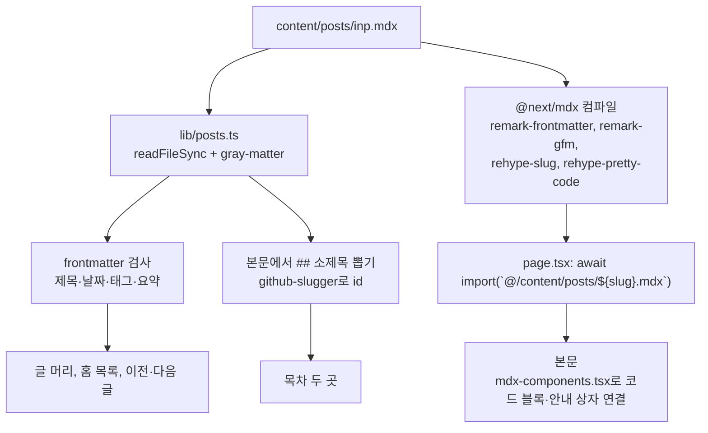

# 계획: 글 본문을 MDX 파일로 쓰기

글을 `content/posts/{slug}.mdx` 파일로 쓰고, 글 상세·홈·이전·다음 글이 이 파일을 읽어 그리게 바꿉니다. 지금은 글 정보가 `lib/posts.ts` 상수에, `inp` 글 본문이 `components/post-bodies/InpPostBody.tsx`의 JSX에, 목차가 손으로 적은 배열에 따로 있습니다. 바꾼 뒤에는 MDX 파일 하나가 제목·날짜·태그·요약(frontmatter)과 본문을 모두 갖고, 목차와 코드 색은 빌드 때 본문에서 만들어집니다. 글 상세 화면의 틀과 스타일은 [post-detail.md](./post-detail.md)에서 만든 것을 그대로 씁니다.

**완료 조건**

- `content/posts/`에 `.mdx` 파일을 하나 추가하면 홈 글 목록, 글 상세, 이전·다음 글에 코드 수정 없이 나타납니다.
- 본문은 마크다운으로 쓰고, 안내 상자(`<Callout>`)와 줄 참조(`<CodeLineRef>`)만 JSX 태그로 씁니다. 둘 다 파일에서 import하지 않고 바로 씁니다.
- 펜스 코드 블록(` ```tsx title="PlanList.tsx" `)이 시안처럼 파일 이름 줄, 복사 버튼, 줄 번호, 시안 색(키워드·함수·주석·문자열)으로 나옵니다. 라이트·다크 테마 모두입니다.
- 목차가 본문의 `##` 소제목에서 만들어지고, 목차 링크와 소제목 `id`가 맞습니다.
- `inp` 글 화면이 지금(`/blog/inp`)과 1280px·375px, 라이트·다크에서 1px 안으로 같습니다.
- `pnpm lint`와 타입 검사를 통과하고, `pnpm build`에서 글 다섯 개가 정적으로 만들어집니다.

## 입력 근거

- 사람 요청: "실제로는 마크다운으로 글을 작성할건데 지금 구현한 것 처럼 하면 안될 것 같은데" → MDX 방향에 동의하고 계획 문서를 요청함
- 이전 작업: [post-detail.md](./post-detail.md) 「대안과 기각 이유」에 "MDX로 바꿀 때 `.post-body` 스타일과 부품 컴포넌트를 그대로 쓴다"고 적었습니다. 결과는 [post-detail.result.md](./post-detail.result.md)에 있습니다
- Next.js 16 문서
  - `node_modules/next/dist/docs/01-app/02-guides/mdx.md`: 설치, `mdx-components.tsx` 필수, 동적 import, frontmatter, Turbopack에서 플러그인 쓰는 법
  - `node_modules/next/dist/docs/01-app/01-getting-started/08-caching.md:447`: `fs.readFileSync`와 모듈 import는 프리렌더 중에 끝나 정적 화면에 들어감
- 디자인 시안: `design/blog-a.html` 144~150행(코드 블록·코드 색), 236~240행(줄 번호·줄 강조), 629~646행(본문 예시)

## 현재 코드 상태

| 위치                                              | 상태                                                            | MDX 전환 뒤                                                       |
| ------------------------------------------------- | --------------------------------------------------------------- | ----------------------------------------------------------------- |
| `lib/posts.ts`                                    | 글 다섯 개를 상수 `POSTS`로 둡니다                              | `content/posts/*.mdx`를 읽는 함수로 바꿈                          |
| `components/post-bodies/InpPostBody.tsx`          | `inp` 본문 JSX와 `INP_POST_TOC`                                 | 지움. 본문은 `content/posts/inp.mdx`로                            |
| `app/blog/[slug]/page.tsx:59-71, 87-91`           | `POST_BODIES` 조회 표, `FULL_BODY_POST_TITLE`, "본문 없음" 안내 | 지움. 모든 글이 본문을 가짐                                       |
| `components/mdx/CodeBlock.tsx`                    | `fileName`과 `<CodeLine>` 자식을 받아 그림                      | 하이라이터가 만든 마크업을 감싸는 틀로 바꿈. `CodeLine`은 지움    |
| `components/mdx/CodeCopyButton.tsx:18`            | 코드 블록 안 `[data-code-line]` 줄을 읽어 복사                  | 읽는 선택자만 하이라이터가 만드는 줄(`[data-line]`)로 바꿈        |
| `components/mdx/Callout.tsx`                      | 자식을 `<p>`로 감쌈                                             | MDX에서 여러 문단을 넣으면 `<p>` 안에 `<p>`가 생겨 `<div>`로 바꿈 |
| `app/globals.css` `.post-body`                    | 본문 요소 스타일을 하위 선택자로 줌                             | 그대로 씀                                                         |
| `components/PostTocInline.tsx`, `PostTocSide.tsx` | `tocItems`를 받아 그림. 현재 위치는 화면의 소제목 `id`로 계산   | 그대로 씀                                                         |
| `components/HomeRecentPosts.tsx`, `PostPager.tsx` | `POSTS` 상수를 읽음                                             | `getPosts()`를 부르게 바꿈                                        |
| `next.config.ts:3-14`                             | `cacheComponents`, `partialPrefetching`, Turbopack CSS 규칙     | `createMDX`로 감쌈                                                |

## 설계

### 구조

```text
content/posts/                    글 파일 (신규)
├─ inp.mdx                        frontmatter + 본문
├─ content.mdx, form.mdx, a11y.mdx, review.mdx

mdx-components.tsx                MDX 태그 → 컴포넌트 연결 (신규, App Router 필수 파일)
next.config.ts                    createMDX와 remark·rehype 플러그인
lib/posts.ts                      getPosts(), getPost(slug): 파일 읽기, frontmatter 검사, 목차 뽑기
app/blog/[slug]/page.tsx          getPost로 글 정보를, 동적 import로 본문을 가져옴
```

### 글 하나가 화면에 나오기까지



글 정보와 본문을 두 갈래로 읽는 이유: 홈과 이전·다음 글은 모든 글의 제목·날짜가 필요한데, 이를 위해 모든 MDX 모듈을 import하면 본문까지 불러옵니다. `lib/posts.ts`는 파일의 frontmatter와 소제목만 읽고, 본문은 글 상세에서만 import합니다. Next.js 문서도 글 목록은 `fs`로 읽으라고 안내합니다(`mdx.md`의 「Frontmatter」).

### frontmatter

```mdx
---
title: '요금제 비교 페이지의 INP를 개선하며 배운 것'
publishedAt: '2026-10-04'
tags: ['성능', 'React']
excerpt: '필터를 누를 때마다 느껴지던 버벅임의 원인을 찾고, 렌더링을 쪼개 입력 반응성을 되찾은 과정을 정리했습니다.'
---

필터 칩을 누르면 결과가 바뀌기까지 미묘한 지연이 있었습니다. ...

## 원인 찾기
```

- slug는 파일 이름입니다(`inp.mdx` → `inp`). frontmatter에 따로 적지 않아 둘이 어긋날 일이 없습니다.
- 날짜는 따옴표로 감쌉니다. YAML은 따옴표 없는 `2026-10-04`를 `Date` 객체로 읽어 `<time dateTime>`과 `toDotDate`에 그대로 쓸 수 없습니다.
- `gray-matter`가 돌려주는 값은 타입이 없습니다. `as` 대신 타입 가드 `isPostFrontmatter`로 검사하고, 맞지 않으면 파일 이름을 넣은 에러를 던져 빌드를 멈춥니다.
- `@next/mdx`는 frontmatter를 모르므로 `remark-frontmatter`로 본문에서 걷어 냅니다. 이 플러그인이 없으면 `---` 블록이 본문에 글자로 찍힙니다.

### `lib/posts.ts`

```ts
export type Post = {
  slug: string;
  title: string;
  publishedAt: string;
  tags: string[];
  excerpt: string;
  tocItems: PostTocItem[];
};

export function getPosts(): Post[]; // 최신순. publishedAt 기준 toSorted
export function getPost(slug: string): Post | undefined;
```

- `readdirSync`·`readFileSync`로 읽습니다. 동기 파일 읽기는 프리렌더 중에 끝나므로 `use cache`나 `<Suspense>`가 필요 없습니다(`08-caching.md:447`).
- 모듈 수준에 한 번 읽어 두지 않고 부를 때마다 읽습니다. 개발 중 frontmatter를 고치면 새로고침만으로 반영되게 하려는 것입니다. 글 수가 적어 비용은 작습니다.
- 목차는 본문을 `mdast-util-from-markdown`에 MDX 문법 확장(`micromark-extension-mdxjs`, `mdast-util-mdx`)을 붙여 읽어 소제목을 순서대로 돌며 `github-slugger`로 `id`를 만듭니다. `rehype-slug`와 같은 라이브러리·같은 순서(모든 깊이의 소제목을 차례로)로 만들어야 같은 이름이 겹칠 때 붙는 `-1` 같은 접미사까지 맞습니다. 그중 `##`(깊이 2)만 목차에 넣습니다.
- 코드 블록 안의 `## ...` 줄은 마크다운 해석기가 코드로 읽어 목차에 들어가지 않습니다. 줄 단위로 `##`를 찾는 방식을 쓰지 않는 이유입니다.

### 글 상세 (`app/blog/[slug]/page.tsx`)

```tsx
const post = getPost(slug);
if (!post) notFound();
const { default: PostBody } = await import(`@/content/posts/${slug}.mdx`);
```

- `getPost`로 먼저 확인한 뒤 import하므로, 없는 slug로 import를 시도하지 않습니다.
- `generateStaticParams`는 `getPosts()`의 slug를 돌려줍니다. `cacheComponents` 때문에 `dynamicParams`를 쓸 수 없는 것은 지금과 같습니다.
- 목차는 `tocItems`가 하나 이상일 때만 그립니다. 비어 있지 않은 배열 타입(`PostToc`)으로 좁히는 데 `as` 대신 타입 가드 `hasTocItems`를 씁니다.

### 코드 블록

`rehype-pretty-code`(Shiki)가 빌드 때 펜스 코드 블록을 색칠하고 줄마다 `<span data-line>`을 만듭니다. `mdx-components.tsx`에서 이 결과를 `CodeBlock` 틀에 넣습니다.

| 시안          | MDX 전환 뒤                                                                                                                                     |
| ------------- | ----------------------------------------------------------------------------------------------------------------------------------------------- |
| 파일 이름 줄  | 펜스의 `title="PlanList.tsx"` → `rehype-pretty-code`가 만드는 제목 요소. 제목이 없으면 언어 이름(`tsx`)을 보여 줍니다                           |
| 복사 버튼     | `CodeCopyButton`을 그대로 씀. 읽는 줄 선택자만 `[data-line]`으로                                                                                |
| 줄 번호       | 지금처럼 CSS 카운터. 카운터를 올리는 대상만 `[data-line]`으로                                                                                   |
| 코드 색       | Shiki 테마의 색 값을 CSS 변수(`var(--kw)`, `var(--accent)`, `var(--subtle)`, `var(--str)`)로 둔 테마 하나. 라이트·다크는 CSS 변수가 바꿔 줍니다 |
| 줄 강조(후속) | 펜스의 `{4-8}`가 `data-highlighted-line`을 붙여 줘서 후속 작업에서 바로 씁니다                                                                  |

코드 색 때문에 [post-detail.md](./post-detail.md)에서 뺀 `--str`(라이트 `#1F7A4D`, 다크 `#7FD1A4`)을 다시 넣습니다. 이제 문자열이 있는 코드도 들어오기 때문입니다.

### MDX에서 쓰는 컴포넌트 (`mdx-components.tsx`)

| MDX에서                               | 연결                                                     |
| ------------------------------------- | -------------------------------------------------------- |
| 펜스 코드 블록                        | `figure`(코드 블록일 때) → `CodeBlock`                   |
| `<Callout>메모 …</Callout>`           | `Callout`. 글 파일에서 import하지 않고 바로 씀           |
| `<CodeLineRef>1번째 줄</CodeLineRef>` | `CodeLineRef`. 지금처럼 모양만 있음                      |
| `#`·`##`·문단·목록·링크·인라인 코드   | 연결 없음. `.post-body` 하위 선택자 스타일이 그대로 적용 |

### `next.config.ts`

```ts
const withMDX = createMDX({
  options: {
    remarkPlugins: ['remark-frontmatter', 'remark-gfm'],
    rehypePlugins: ['rehype-slug', ['rehype-pretty-code', { theme: /* CSS 변수 테마 JSON */, keepBackground: false }]],
  },
});
export default withMDX(nextConfig);
```

이 레포는 Turbopack을 쓰므로 플러그인을 문자열 이름으로 넘기고, 옵션도 JSON으로 옮길 수 있는 값만 씁니다. 함수는 넘길 수 없습니다(`mdx.md`의 「Using Plugins with Turbopack」). `pageExtensions`에는 `mdx`를 넣지 않습니다. 글은 라우트 파일이 아니라 import 대상이기 때문입니다.

### 추가할 패키지

| 패키지                                                               | 버전                   | 용도                                                          |
| -------------------------------------------------------------------- | ---------------------- | ------------------------------------------------------------- |
| `@next/mdx`                                                          | 16.4.2 (`next`와 같게) | MDX 컴파일 연결                                               |
| `@mdx-js/loader`, `@mdx-js/react`                                    | 3.1.1                  | `@next/mdx`의 peer 의존성                                     |
| `@types/mdx`                                                         | 2.0.14 (dev)           | `.mdx` import 타입                                            |
| `remark-frontmatter`                                                 | 5.0.0                  | 본문에서 frontmatter 걷어 내기                                |
| `remark-gfm`                                                         | 4.0.1                  | 표·취소선·자동 링크                                           |
| `rehype-slug`                                                        | 6.0.0                  | 소제목 `id`                                                   |
| `rehype-pretty-code`, `shiki`                                        | 0.14.6, 4.6.0          | 코드 색·줄 마크업                                             |
| `gray-matter`                                                        | 4.0.3                  | 목록용 frontmatter 읽기                                       |
| `mdast-util-from-markdown`, `mdast-util-to-string`, `github-slugger` | 2.1.0, 4.0.0, 2.0.0    | 목차 뽑기                                                     |
| `micromark-extension-mdxjs`, `mdast-util-mdx`                        | 3.0.0, 3.0.0           | 목차를 MDX 컴파일러와 같은 문법으로 읽기 (사람 결정으로 추가) |

로컬 pnpm 8.14.1은 이 레포의 lockfile(v9)을 읽지 못해 `npx pnpm@10 add`로 설치합니다. 이번에는 `pnpm-lock.yaml`이 바뀝니다.

### 대안과 기각 이유

| 대안                                           | 기각 이유                                                                                                |
| ---------------------------------------------- | -------------------------------------------------------------------------------------------------------- |
| 순수 `.md` 파일                                | 안내 상자와 "N번째 줄" 버튼을 쓸 문법이 없습니다. MDX도 본문은 마크다운이라 평소 쓰는 방식은 같습니다    |
| `next-mdx-remote`로 문자열을 런타임 컴파일     | Next.js 문서가 안내하는 방식이 `@next/mdx`이고, 파일이 레포 안에 있어 원격 컴파일이 필요 없습니다        |
| Contentlayer·Velite 같은 콘텐츠 도구           | 글 다섯 개에 빌드 단계와 설정 파일이 하나 더 늘어납니다. 필요해지면 `lib/posts.ts` 자리만 바꾸면 됩니다  |
| frontmatter 대신 MDX의 `export const metadata` | 마크다운 편집기·미리보기에서 메타 정보가 깨져 보입니다. 목록을 만들려면 모든 글 모듈을 import해야 합니다 |
| 목차를 `remark-toc`로 본문 안에 넣기           | 시안은 목차를 본문 밖 두 곳(본문 위, 오른쪽)에 둡니다. 본문 안에 넣는 플러그인과 맞지 않습니다           |
| Shiki 기본 테마(`github-light`/`github-dark`)  | 시안 색(키워드 보라, 함수 accent, 주석 subtle)과 다릅니다                                                |
| 하이라이터 없이 코드만 그리기                  | 시안의 코드 색과 후속 작업인 줄 강조를 맞출 수 없습니다                                                  |

### 변경 파일

| 파일                                                         | 작업                                                                           |
| ------------------------------------------------------------ | ------------------------------------------------------------------------------ |
| `package.json`, `pnpm-lock.yaml`                             | 패키지 추가                                                                    |
| `next.config.ts`                                             | `createMDX`로 감싸고 플러그인 설정                                             |
| `mdx-components.tsx`                                         | 신규. 코드 블록·`Callout`·`CodeLineRef` 연결                                   |
| `content/posts/*.mdx`                                        | 신규 5개. `lib/posts.ts`의 글 정보와 `InpPostBody` 본문을 옮김                 |
| `lib/posts.ts`                                               | 상수 `POSTS`를 `getPosts`·`getPost`로. frontmatter 타입 가드, 목차 뽑기        |
| `app/blog/[slug]/page.tsx`                                   | 동적 import로 본문, `POST_BODIES`·`FULL_BODY_POST_TITLE`·"본문 없음" 안내 지움 |
| `components/mdx/CodeBlock.tsx`                               | 하이라이터 마크업을 감싸는 틀로. `CodeLine` 지움                               |
| `components/mdx/CodeCopyButton.tsx`                          | 줄 선택자를 `[data-line]`으로                                                  |
| `components/mdx/Callout.tsx`                                 | 내용을 `<div>`로 감쌈                                                          |
| `components/HomeRecentPosts.tsx`, `components/PostPager.tsx` | `POSTS` 대신 `getPosts()`                                                      |
| `app/globals.css`                                            | `--str` 토큰 다시 추가                                                         |
| `components/post-bodies/InpPostBody.tsx`                     | 삭제                                                                           |
| `tsconfig.json`                                              | `.mdx` import 타입이 잡히지 않으면 `@types/mdx` 연결 (확인 필요)               |

## 정책과 엣지 케이스

| 상황                                    | 기대 동작                                                                                                             |
| --------------------------------------- | --------------------------------------------------------------------------------------------------------------------- |
| frontmatter 필드가 빠졌거나 타입이 틀림 | `pnpm dev`·`pnpm build`가 파일 이름과 필드를 담은 에러로 멈춥니다                                                     |
| 날짜를 따옴표 없이 씀                   | 위와 같이 에러로 멈춥니다. 조용히 잘못된 날짜를 그리지 않습니다                                                       |
| 같은 날짜의 글 두 개                    | 정렬 결과가 매번 같도록 날짜가 같으면 slug 순으로 둡니다                                                              |
| `content/posts/`에 `.mdx`가 아닌 파일   | 무시합니다                                                                                                            |
| 없는 slug                               | 지금처럼 404입니다                                                                                                    |
| `##` 소제목이 없는 글                   | 목차 두 곳을 그리지 않습니다                                                                                          |
| 같은 이름의 소제목 두 개                | `원인-찾기`, `원인-찾기-1`처럼 `id`가 갈리고 목차 링크도 각자 맞는 곳으로 갑니다                                      |
| 한글 소제목                             | `id`가 `원인-찾기`처럼 한글로 남고, 주소에는 인코딩되어 붙습니다. 목차 클릭과 현재 위치 표시가 지금과 같이 동작합니다 |
| 코드 블록 안의 `## ` 줄                 | 목차에 들어가지 않습니다                                                                                              |
| 제목 없는 코드 블록                     | 머리 줄에 언어 이름을 보여 줍니다                                                                                     |
| 언어 없는 코드 블록                     | 색 없이 그리고, 머리 줄에는 복사 버튼만 있습니다                                                                      |
| 빈 줄이 있는 코드                       | 빈 줄에도 줄 번호가 붙고, 복사하면 빈 줄이 그대로 들어갑니다                                                          |
| `<Callout>` 안에 여러 문단              | 문단마다 `<p>`로 나오고 `<p>` 안에 `<p>`가 생기지 않습니다                                                            |
| 다크 테마                               | 코드 색이 CSS 변수를 따라 다크 값으로 바뀝니다                                                                        |

## 후속 작업

| 항목                               | 이번에 뺀 이유                                                                                                    |
| ---------------------------------- | ----------------------------------------------------------------------------------------------------------------- |
| 줄 참조 hover·클릭 시 코드 줄 강조 | 마크업 준비(`data-highlighted-line`)까지만 합니다. 동작은 [post-detail.md](./post-detail.md) 후속 작업과 같습니다 |
| 읽기 진행 막대, 이어 읽기, 맨 위로 | [post-detail.md](./post-detail.md) 후속 작업 그대로입니다                                                         |
| TIL도 MDX로                        | 요청 범위 밖입니다. 같은 `lib` 구조를 TIL에 쓸 수 있습니다                                                        |
| RSS·검색                           | 글 목록을 읽는 함수(`getPosts`)가 생기면 바로 쓸 수 있습니다                                                      |

## 미결 사항

1. **확인 필요 (구현 중 확인)**
   - Turbopack에서 `rehype-pretty-code`의 `theme`에 JSON 객체(CSS 변수 테마)를 넘길 수 있는지. 안 되면 테마 파일을 별도로 두는 방법을 찾고, 그래도 안 되면 계획 변경으로 다시 묻습니다.
   - `rehype-pretty-code`가 제목·언어를 어느 요소의 어떤 속성에 붙이는지. `CodeBlock`이 읽을 위치를 이 결과에 맞춥니다.
   - 빈 줄을 `<span data-line>`으로 남기는지.
2. **검증 방법.** 테스트 러너가 없어 단위 테스트는 쓰지 않습니다. `pnpm lint`·타입 검사, 브라우저에서 지금 화면과 비교해 확인합니다. 정적 생성 확인에 `pnpm build`가 필요해, QA 때 실행해도 되는지 그때 묻겠습니다.

**결정됨**

- 글 상세 화면 작업([post-detail.md](./post-detail.md))과 이 작업을 한 PR로 올립니다. (사람 결정)
- 나머지 네 글은 요약 한 문단을 본문으로 둔 `.mdx`로 둡니다. 홈 글 목록이 시안처럼 다섯 글을 유지합니다. (사람이 답하지 않아 작업자가 정함. 바꿀 수 있음)
